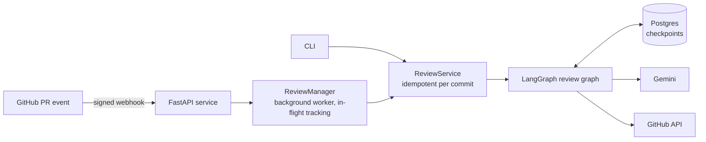
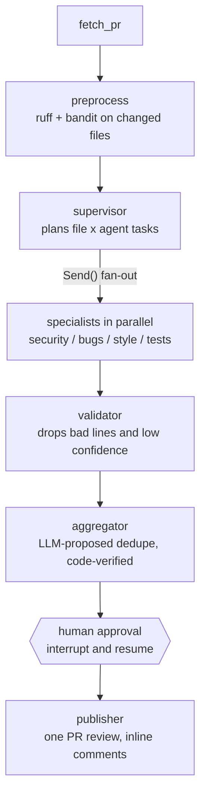

# PR Reviewer: a multi-agent code review service built with LangGraph

An agentic service that reviews GitHub pull requests. A supervisor routes each
changed file to specialist agents (security, bugs, style, test coverage) that
run in parallel. Their findings are validated, deduplicated, ranked, and posted
as inline PR comments **only after a human approves them**.

## Architecture



### The review graph



## Key design decisions

| Decision | Why |
|---|---|
| **Supervisor + `Send()` fan-out** | One task per (file, agent) pair runs in parallel; reducers merge results safely |
| **Static analysis grounding** | ruff and bandit run on the full file and only their findings on *changed* lines are given to agents as hints, which cuts hallucination |
| **Two-schema structured output** | The LLM fills a small `RawFinding`; code adds file, category and agent, so the model can't get those wrong |
| **Validator** | Findings on lines not in the diff (a hallucination signal GitHub would also reject) or below 0.6 confidence are dropped |
| **LLM proposes, code disposes** | The LLM suggests which findings are duplicates; code enforces same-file, nearby-lines, no-overlap rules before merging. Falls back to exact-match dedupe if the LLM fails |
| **Human-in-the-loop** | The graph pauses with `interrupt()`, state is saved in Postgres, and it resumes when a human picks findings. LLM output derived from untrusted code is never posted unreviewed |
| **Idempotency** | Thread ID is `repo#pr@commit_sha`, so webhook redeliveries and repeat requests reuse the saved review instead of paying for another |
| **Failure isolation** | A failed specialist is recorded in `errors` and the rest finish; the review is flagged `degraded` |
| **Prompt-injection hygiene** | PR text and diffs are declared untrusted in every system prompt, and `@mentions` are defused before posting |

## Reliability

- **Error classification**: daily quota, per-minute rate limit, transient (5xx, timeout), and fatal errors are handled differently.
- **Server-advised backoff**: per-minute limits wait the delay Gemini specifies; 5xx and timeouts use exponential backoff with jitter.
- **Circuit breaker**: after a daily-quota error all LLM calls fail instantly until the quota resets, instead of every agent burning time on doomed requests.
- **Diff chunking**: large files are split by hunk (and by line inside a giant hunk) with real line numbers preserved, capped at 3 chunks per file.
- **Bounded worker pool**: the API queues reviews on one worker so concurrent PRs cannot exhaust the LLM quota.
- **Forced re-run**: `--force` / `"force": true` discards a saved review (refused once its comments were published).

## Tech stack

Python 3.11, LangGraph, LangChain, Gemini (free tier), FastAPI, Postgres
(LangGraph checkpointer, psycopg pool), PyGithub, ruff, bandit, LangSmith, pytest.

## Project layout

```
app/
  agents/     supervisor, specialists, registry, validator, aggregator, shared runner
  api/        FastAPI app, review and webhook routes, HMAC verification
  core/       config, LLM factory, resilience (retries, circuit breaker), checkpointer, tracing
  graph/      state, nodes, graph builder
  schemas/    pull request, finding, static-analysis, and review models
  services/   ReviewService (lifecycle), ReviewManager (background jobs)
  tools/      GitHub client, diff parser and chunker, ruff/bandit runners, comment formatter
eval/         labeled dataset, scoring, record-and-replay LLM cache, runner
scripts/      CLI review, webhook simulator
tests/        offline test suite (no network, no LLM)
```

## Getting started

```bash
python -m venv .venv && source .venv/bin/activate   # Windows: .\.venv\Scripts\Activate.ps1
pip install -r requirements.txt
cp .env.example .env                                  # then fill in the values below
```

Create a Postgres database (for example `pr_reviewer_db`); checkpoint tables are created automatically.

| Variable | Purpose |
|---|---|
| `GOOGLE_API_KEY` | Gemini API key (free tier works) |
| `GEMINI_MODEL` | Model name, e.g. `gemini-2.5-flash` |
| `GITHUB_TOKEN` | Fine-grained token: Pull requests (read/write), Contents (read) |
| `GITHUB_WEBHOOK_SECRET` | Shared secret for webhook signature verification |
| `DATABASE_URL` | Postgres connection string |
| `LLM_MAX_CONCURRENCY`, `LLM_MAX_RETRIES` | Parallel LLM calls and retry count |
| `LANGSMITH_TRACING`, `LANGSMITH_API_KEY`, `LANGSMITH_PROJECT` | Optional tracing |

## Usage

**CLI** (reviews a PR, lists findings, asks which to post):
```bash
python -m scripts.run_review https://github.com/OWNER/REPO/pull/1
python -m scripts.run_review https://github.com/OWNER/REPO/pull/1 --force
```

**API**:
```bash
uvicorn app.api.main:app --port 8000      # interactive docs at /docs
```

| Endpoint | Purpose |
|---|---|
| `POST /reviews` | Queue a review (`202`); body: `{"pr_url": "..."}` or `{"repo": "o/r", "pr_number": 1}`, optional `"force": true` |
| `GET /reviews/{owner}/{repo}/{pr}/{sha}` | Status and findings |
| `POST /reviews/{owner}/{repo}/{pr}/{sha}/approve` | `{"approved": [0, 2]}` or `{"approve_all": true}` |
| `POST /webhooks/github` | Signed `pull_request` events start reviews automatically |
| `GET /health` | Liveness |

Try the webhook without a public URL: `python -m scripts.send_test_webhook OWNER/REPO 1`

## Testing

```bash
pytest -v        # 88 tests, fully offline: fake GitHub, fake LLM, in-memory checkpointer
```

The suite covers the diff parser, validator, aggregator, supervisor routing, graph fan-out,
failure isolation, human approval flow, idempotency, API and webhook security, retry and
circuit-breaker logic (using real Gemini error messages), chunking, and the eval harness.

## Evaluation

`python -m eval.run_eval` scores the security and bugs agents on a labeled set of 12 small
pull requests (7 security issues, 3 bugs, 2 clean files). Issues are labeled by an *anchor*
(text on the offending line), and a finding matches if it is in the same file within 2 lines.

LLM responses are cached on disk, keyed by a hash of the exact prompt. Re-runs are free,
interrupted runs resume, changing a prompt re-queries only what changed, and the committed
cache lets anyone reproduce the numbers with no API key.

| Metric | Result |
|---|---|
| Recall | _fill in_ (x/y labeled issues found) |
| Precision | _fill in_ |
| Clean-code false alarms (medium or worse) | _fill in_ |

Caveats: a small synthetic set labeled by hand. Precision is conservative, because a
legitimate finding that is not labeled counts as a false positive. Style and test-coverage
agents are not scored.

## Observability

With LangSmith enabled, every review is one `pr-review` trace tagged with repo, PR number
and commit, showing the graph, the parallel specialists, and each LLM call's prompt, output
and latency.

## Limitations and next steps

- The in-flight job tracker lives in process memory; running several API workers would need a
  shared lock (Redis or a Postgres advisory lock) and a real job queue (Celery or RQ).
- Free-tier Gemini limits (5 requests/min, 20/day on the model used here) shape the design:
  bounded concurrency, a circuit breaker, and a cached evaluation.
- Static-analysis grounding supports Python only; other languages rely on the LLM alone.
- Very large PRs are capped (3 chunks per file) rather than fully reviewed.
- Possible next steps: a proactive rate limiter, an LLM-based supervisor, multi-repo
  tenancy, and a small web UI for the approval step.